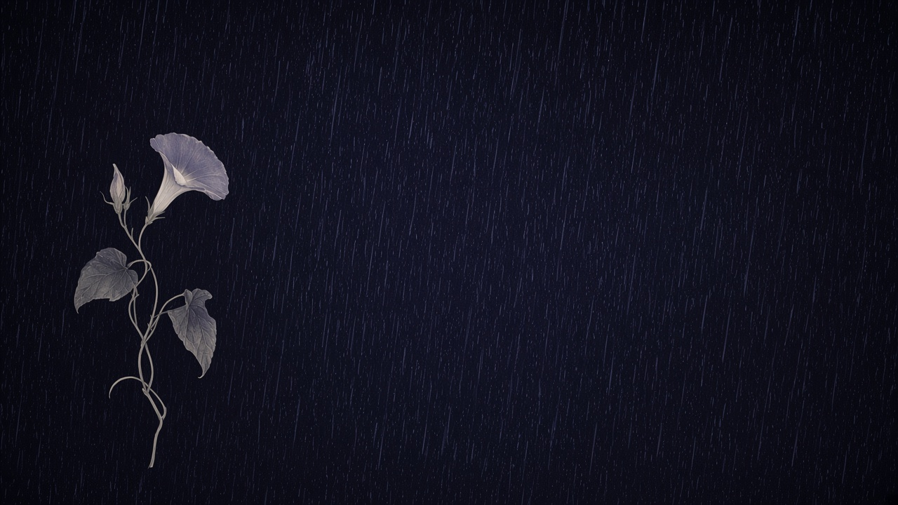

<p align="center">
  
</p>

<p align="center"><sub>雨还在下</sub></p>

# Nyarch 说明

Nyarch 是带安装器和一套桌面的 Arch。包还是 `pacman`，AUR 也能用。这篇记第一次开机、GNOME 的配色，以及之后换到 niri。镜像只从下面的地址下。

## 下载

- 官网：[nyarchlinux.moe](https://nyarchlinux.moe/)
- 组织：[github.com/NyarchLinux](https://github.com/NyarchLinux)
- ISO：[SourceForge](https://sourceforge.net/projects/nyarchlinux/) 或 [GitHub Releases](https://github.com/NyarchLinux/NyarchLinux/releases)

上游：

- [archlinux.org](https://archlinux.org/)
- [ArchWiki 中文](https://wiki.archlinux.org/title/Main_page_(简体中文))
- [AUR](https://aur.archlinux.org/)
- 镜像：[清华](https://mirrors.tuna.tsinghua.edu.cn/archlinux/)、[中科大](https://mirrors.ustc.edu.cn/archlinux/)

## 装完第一件事

安装器是 Calamares。进去之后：

```bash
sudo pacman-mirrors -i -c China -m rank
sudo pacman -Syu

sudo pacman -S --needed base-devel git
git clone https://aur.archlinux.org/yay.git && cd yay && makepkg -si
```

`pacman-mirrors` 没有的话，直接改 `/etc/pacman.d/mirrorlist`。

## GNOME 的颜色

Nyarch 的 GNOME 会在换壁纸时跑 `~/.config/nyarch/after_wp_change.sh`：从壁纸取一个颜色，写到 `~/.config/gtk-4.0/gtk.css`，并换 Tela-circle-MaterialYou 的图标。

常用的几个：图标主题 `Tela-circle-icon-theme`，终端里是 fastfetch、starship、fish。

## 换到 niri

窗口横着排，用 Super + H / L 移动。不会像 i3 那样把屏幕越切越窄。

配置在 [dotfiles](https://github.com/shenchuchu91-hub/dotfiles)：

```text
~/.config/niri/config.kdl
~/.config/niri/layout.kdl
~/.config/niri/animations.kdl
~/.config/niri/blur.kdl
~/.config/niri/shorin-windowrules.kdl
```

`shorin-windowrules.kdl` 整理自 [SHORiN-KiWATA](https://github.com/SHORiN-KiWATA)。QQ、微信、播放器要浮动还是平铺，写在这个文件里。

## 另外三件

1. 独显：看 [moe-game-launcher](https://github.com/shenchuchu91-hub/moe-game-launcher)。
2. 中文：`fcitx5` 和 `fcitx5-chinese-addons`，环境变量里要有 `XMODIFIERS=@im=fcitx` 和 `GTK_IM_MODULE=fcitx`。
3. 高刷新率屏幕可以用 Gamescope 锁到屏幕自己的刷新率，比如 144。

<p align="center"><sub>雨还在下</sub></p>
